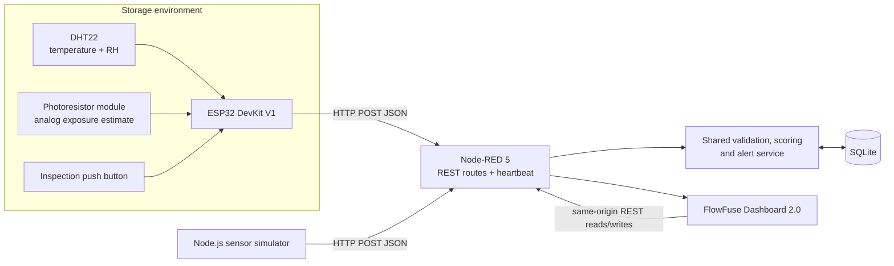

# Pharmaceutical Storage Monitoring System

An end-to-end prototype for monitoring a medicine storage environment with an ESP32, DHT22, photoresistor and inspection button. The ESP32 submits JSON over HTTP to Node-RED. A shared Node.js service validates readings, calculates a Medicine Storage Score, records sensor/inspection/alert history in SQLite, and supplies the API and Dashboard 2.0.

> **Prototype limits are not pharmaceutical guidance.** The initial ranges (15–25 °C, 30–60% RH and 30% normalized light exposure) are demonstration values only. Obtain actual storage requirements from the medicine manufacturer's labeling and applicable regulations. This prototype is not a validated or calibrated monitoring instrument.

## Features

- Live temperature, relative humidity and normalized light-exposure readings, including a connected-device status and last communication time.
- Weighted score breakdown (temperature 45%, humidity 35%, light 20%) with hard-limit alerts overriding a reassuring aggregate classification.
- SQLite history for readings, devices, alerts and inspections, initialized automatically on start.
- REST API for telemetry, latest reading, history with pagination, score, alerts, inspection records, devices and health.
- Alert state transitions that suppress duplicate active conditions and write recovery events.
- Dashboard 2.0 view with responsive status cards, live indicators, SVG history charts, alert acknowledgement, inspection requests and inspection history.
- Physical button event reporting, retry queues on the ESP32, a realistic Node.js simulator and a Postman collection.
- Local-only startup by default. No tunnel is needed for local development or the Node.js simulator.

## Architecture



See [architecture](docs/architecture.md), [API reference](docs/api-documentation.md), [database schema](docs/database-schema.md), [scoring](docs/scoring-algorithm.md), [hardware setup](docs/hardware-setup.md) and [troubleshooting](docs/troubleshooting.md).

## Requirements

- macOS with Node.js **22.13 or newer** and npm. Node's built-in `node:sqlite` avoids a native SQLite package.
- Internet access during setup to install Node-RED and FlowFuse Dashboard 2.0.
- PlatformIO CLI or the PlatformIO VS Code extension for firmware builds; Wokwi for VS Code/CLI for simulation.
- Optional physical ESP32, DHT22, photoresistor voltage-divider module, push button and a 4.7–10 kΩ DHT22 data pull-up resistor.

The Dashboard dependency is [`@flowfuse/node-red-dashboard`](https://dashboard.flowfuse.com/getting-started.html) (Dashboard 2.0). It is installed inside the Node-RED user directory by setup. The deprecated `node-red-dashboard` package is not used.

## Install and run locally

```sh
cd pharmaceutical-storage-monitoring
bash scripts/setup.sh
```

Review `.env` after setup. Set the limits for the specific product/storage condition before using readings for operational decisions. Start Node-RED and the dashboard:

```sh
npm start
```

- Dashboard: [http://127.0.0.1:1880/dashboard/overview](http://127.0.0.1:1880/dashboard/overview)
- Node-RED editor: [http://127.0.0.1:1880/red](http://127.0.0.1:1880/red)
- API health: [http://127.0.0.1:1880/api/health](http://127.0.0.1:1880/api/health)

The database is created at `data/pharma.sqlite` on first startup. The checked-in `node-red/flows.json` contains the HTTP routes, heartbeat check, dashboard configuration and Vue template. `npm start` regenerates it from `node-red/dashboard-ui.vue` and the two dispatcher source files. To edit imported flows in the editor, export updated flows and keep the template source and generated flow synchronized with `npm run build:flow`.

Run the simulator from a second terminal:

```sh
npm run simulate -- --scenario cycle --interval-ms 1000
```

`cycle` generates nominal values with a brief periodic excursion so the alert and recovery lifecycle can be observed. Other options:

```sh
npm run simulate -- --scenario normal --count 10 --interval-ms 1000
npm run simulate -- --scenario unsafe --count 5 --device-id DEMO_DEVICE_02
npm run simulate -- --help
```

`--interval-ms` has a 1,000 ms minimum. Stop a continuous simulation with Ctrl+C. The API default is Node-RED at `http://127.0.0.1:1880`; override it with `--base-url`.

## REST API

All API paths are served by Node-RED and documented in [docs/api-documentation.md](docs/api-documentation.md). Main endpoints:

| Method | Path | Purpose |
|---|---|---|
| POST | `/api/sensor-data` | Validate and store a sensor reading, score it and transition alerts |
| GET | `/api/latest` | Latest reading, current device status and current score |
| GET | `/api/history` | Filtered and paginated history |
| GET | `/api/score` | Latest score and component breakdown |
| POST | `/api/inspection` | Save a manual or physical-button inspection request |
| GET | `/api/inspections` | Inspection history |
| GET | `/api/alerts` | Alert history; filter severity/date/device/active state |
| PATCH | `/api/alerts/:id/acknowledge` | Acknowledge an alert |
| GET | `/api/devices` | Device status and last communication |
| GET | `/api/health` | API, database, counts and active thresholds |

Start the standalone API on port 3000 for backend-only development with `npm run start:api`. This server shares the same SQLite service, but it does not host the Node-RED Dashboard. Set `API_HOST` and `API_PORT` in `.env` to change its bind address and port.

## Dashboard and Node-RED setup

`bash scripts/setup.sh` installs Node-RED in the project and installs `@flowfuse/node-red-dashboard` into `node-red/data`, the configured Node-RED user directory. It creates `.env` from `.env.example`, initializes working folders and regenerates the flows. `npm start` launches Node-RED using [node-red/settings.js](node-red/settings.js).

For a separately managed Node-RED installation, install `@flowfuse/node-red-dashboard` from the palette manager (or in that runtime's user directory), then import `node-red/flows.json`. Its `settings.js` must load the service at `backend/service.js` as `functionGlobalContext.pharmaService`, and point `flowFile` to the imported file. The generated flow uses only core HTTP, inject and function nodes plus FlowFuse Dashboard 2.0.

If only the Dashboard palette is unavailable, run `npm run start:nodered:api-only` to launch the same REST API/SQLite backend with Node-RED but without Dashboard nodes. It does not provide a dashboard URL. The normal `npm start` intentionally requires Dashboard 2.0 so it cannot appear to succeed while silently omitting the requested UI.

## Firmware and Wokwi

See [hardware setup](docs/hardware-setup.md) and [firmware README](firmware/README.md). The wiring file is [wokwi/diagram.json](wokwi/diagram.json), using Wokwi's documented ESP32 DevKit V1, DHT22, photoresistor sensor, pushbutton and resistor part identifiers. Build firmware with PlatformIO from `firmware/`, then launch Wokwi from `wokwi/` using its `wokwi.toml`.

For simulator-to-local Node-RED networking, use the **Wokwi private IoT Gateway** and set `API_BASE_URL` in `firmware/include/config.h` to `http://host.wokwi.internal:1880`. Wokwi's public gateway cannot initiate connections to services on your computer. Private-gateway use requires the supported Wokwi VS Code workflow; local network access varies by Wokwi plan/browser. A physical device should use the Node-RED host's reachable LAN address.

For off-site hardware, expose only the sensor-ingest route through a properly configured HTTPS tunnel/reverse proxy, set `PHARMA_INGEST_TOKEN` in `.env`, configure the same `API_BEARER_TOKEN` in the untracked firmware `config.h`, and configure a trusted root CA in `API_TLS_ROOT_CA`. The firmware refuses HTTPS when CA validation is not configured. Do not expose the Node-RED editor or the full API publicly. Further guidance is in [hardware setup](docs/hardware-setup.md).

## Postman and tests

Import `postman/Pharmaceutical-Storage.postman_collection.json` into Postman. Set `baseUrl` to `http://127.0.0.1:1880`; the collection includes valid/invalid telemetry, queries, inspection actions, acknowledgement, devices and health.

Run the local unit and HTTP API integration suite; see the [verification report](docs/test-report.md) for what was and was not executable in this environment:

```sh
npm test
# or
bash scripts/test.sh
```

The integration tests bind a temporary service to an ephemeral loopback port and use temporary SQLite files. They cover payload validation, idempotency, scoring, alerts and recovery, offline status, filters/pagination, inspection requests, token enforcement, malformed JSON and database persistence. These tests do not simulate hardware or claim a Wokwi run.

## Limitations and next steps

- The LDR percentage is a normalized ADC-derived exposure proxy, not calibrated lux. Calibrate the circuit/sensor or add a calibrated lux sensor before relying on exposure values.
- ESP32 retries are in-memory and bounded (20 readings and 10 inspections); they are lost on reset, and the oldest queued item is dropped if a queue fills.
- DHT22 and Wi-Fi/HTTP timing, ADC behavior, Wokwi private-gateway networking, Dashboard rendering and physical wiring require verification on the target hardware/simulator.
- The DHT library selected is Wokwi's ESP32-compatible recommendation; it is an older upstream release. Confirm it against the exact ESP32 Arduino core and sensor hardware used.
- There is no regulatory validation, calibration certificate, redundant sensor, tamper-evident audit log or high-availability database.

## Project contents

```text
backend/       Shared Node.js REST service and standalone API listener
database/      SQLite schema
firmware/      PlatformIO Arduino ESP32 firmware
node-red/      Settings, generated flows and Dashboard 2.0 Vue template
wokwi/         Wokwi diagram and simulation configuration
simulator/     Realistic HTTP telemetry simulator
postman/       Importable API collection
tests/         Unit and HTTP integration tests
docs/          Architecture, API, hardware, scoring, database and troubleshooting
scripts/       Setup, startup, flow generation and test commands
```
