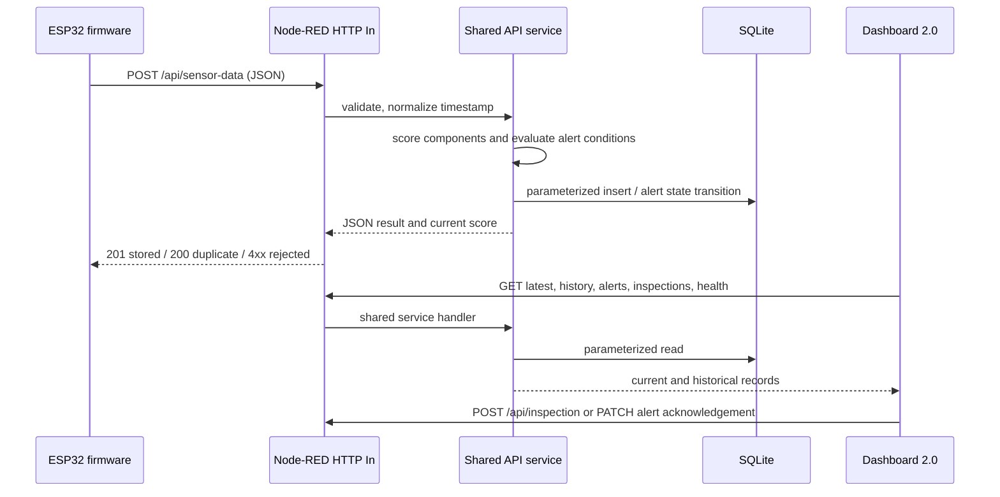

# Architecture

## Components

- **ESP32** reads the DHT22, ADC input and debounced active-low button. It connects to Wi-Fi, samples periodically, adds a UTC timestamp after NTP sync, and POSTs JSON. The in-memory bounded queue backs off on HTTP/network failures.
- **Node-RED** owns API routes and a 15-second device-heartbeat timer. Routes invoke the shared `backend/service.js` module from Node-RED Function nodes via `functionGlobalContext` in `node-red/settings.js`.
- **Service** performs validation, score calculation, alert transitions, query filtering, and SQLite reads/writes. It uses Node 22.13+'s built-in synchronous SQLite API; no native database package is required.
- **SQLite** persists sensor samples, device heartbeats, alert state/history and inspection records under `data/`.
- **FlowFuse Dashboard 2.0** mounts at `/dashboard/overview`. Its Vue component polls same-origin APIs and renders values returned by the backend; the page contains no seeded sensor data.
- **Simulator** submits realistic HTTP telemetry to the same `/api/sensor-data` route, so API tests and dashboard views exercise production paths.

## Data flow and failure behavior

1. A valid unique `(device_id, timestamp)` sample inserts one reading. Duplicate keys return HTTP 200 without adding another record. The server's ingest time separately updates device online status.
2. Out-of-limit values are accepted as valid measurements, stored, scored, and emit alerts. Malformed/missing sensor fields are rejected with HTTP 400 and create a deduplicated invalid/missing-reading alert if a valid device ID is available.
3. Active alerts are unique per device and condition. Repeated readings preserve the active alert; a recovered condition closes it and inserts an informational recovery event referencing the original alert.
4. A valid reading resolves an active missing/invalid/offline alert. The heartbeat flow checks device timeouts independently of browser/dashboard activity.
5. A stale latest sample is returned with `environmental_status: Unavailable` and a null score breakdown. Historical readings retain the score recorded at ingestion.
6. API errors are JSON `{ "error": { "code", "message", "details?" } }` and include a consistent HTTP status.

## Persistence and scaling

The current project deliberately targets a single local Node-RED process and SQLite file. SQLite uses WAL mode, a 5-second busy timeout, parameterized statements, a unique sensor natural key and query indexes. For multiple backend workers, remote ingest or regulated audit requirements, choose a service/database architecture with transactions, identity, access control and retention requirements explicitly designed for that deployment.
